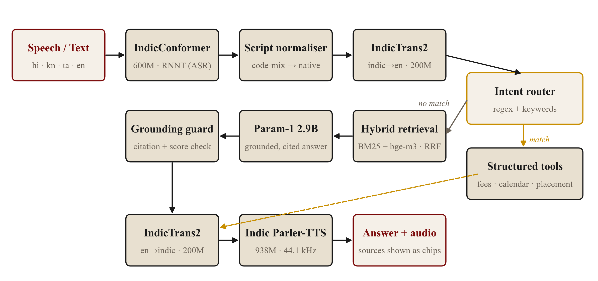

# Study Guide: How the RVU Voice Assistant Produces an Answer

This guide walks through everything that happens between a student speaking a question and the assistant
speaking the answer back, one stage at a time. For each stage it covers what goes in and what comes out,
which model or tool does the work, how that model works inside, and why the project does it this way.
File and function names point to where the code lives, so you can read the guide with the code open.

Contents:

1. [The whole system on one page](#1-the-whole-system-on-one-page)
2. [Before any question: building the knowledge base](#2-before-any-question-building-the-knowledge-base)
3. [Starting the server](#3-starting-the-server)
4. [Following one question through the pipeline](#4-following-one-question-through-the-pipeline)
5. [The tool path: answers without the language model](#5-the-tool-path-answers-without-the-language-model)
6. [Turning the answer into speech](#6-turning-the-answer-into-speech)
7. [How the system is evaluated](#7-how-the-system-is-evaluated)
8. [Design decisions and trade-offs](#8-design-decisions-and-trade-offs)
9. [Known limitations](#9-known-limitations)
10. [Glossary](#10-glossary)
11. [Self-test questions](#11-self-test-questions)

---

## 1. The whole system on one page

A question can arrive as speech or typed text, in Hindi (`hi`), Kannada (`kn`), Tamil (`ta`) or English (`en`).
The system works in English internally, because the language model, Param-1, only understands English and
Hindi. So every question is translated into English, answered in English, and translated back.

There are two ways to answer:

- **Tool path (dashed arrows):** fee, calendar, placement, vision and programme questions are answered by
  plain Python code that looks the facts up in structured JSON files. No language model is involved, so the
  numbers can't be made up.
- **Retrieval path (solid arrows):** every other question goes through retrieval-augmented generation (RAG).
  The system finds the most relevant passages, asks Param-1 to answer from those passages only, and a
  grounding guard checks the answer before it reaches the user.

Both paths end the same way: the English answer is translated into the user's language, shown on screen with
its sources, and read aloud by Indic Parler-TTS when the user presses Listen.

### The models

| Stage | Model | Size | Runs on | Made by |
|-------|-------|------|---------|---------|
| Speech recognition | IndicConformer 600M multilingual | 600M parameters | CPU | AI4Bharat (IIT Madras) |
| Translation, Indian language to English | IndicTrans2 indic-en distilled | 200M | CPU | AI4Bharat |
| Translation, English to Indian language | IndicTrans2 en-indic distilled | 200M | CPU | AI4Bharat |
| Passage embeddings | bge-m3 | 568M | CPU or Apple GPU, float16 | BAAI |
| Answer generation | Param-1 2.9B Instruct | 2.9B | Apple GPU (MPS), float16 | BharatGen |
| Speech synthesis | Indic Parler-TTS | 938M | CPU | AI4Bharat |

All of them run locally on a 16 GB M1 Pro laptop; nothing is sent to a cloud API. The model IDs are set in
`.env` (see `.env.example`) and read by `backend/app/config.py`.

### The code layout

| File | Job |
|------|-----|
| `scripts/ingest.py` | Builds the knowledge base and the search index (run once) |
| `backend/app/main.py` | FastAPI server: `/api/transcribe`, `/api/ask`, `/api/speak`, `/api/sources/{id}` |
| `backend/app/pipeline/asr.py` | Speech recognition with IndicConformer |
| `backend/app/pipeline/codemix.py` | Script normaliser for English spoken in an Indian script |
| `backend/app/pipeline/translate.py` | IndicTrans2 in both directions |
| `backend/app/pipeline/tools.py` | The intent router and the five structured tools |
| `backend/app/pipeline/retrieve.py` | BM25 + bge-m3 hybrid retrieval |
| `backend/app/pipeline/generate.py` | Param-1 prompt and generation |
| `backend/app/pipeline/guard.py` | Grounding guard and refusal messages |
| `backend/app/pipeline/orchestrator.py` | Runs the stages above in order for `/api/ask` |
| `backend/app/pipeline/tts.py` | Indic Parler-TTS |
| `frontend/src/` | React interface (recording, answer card, sources, playback) |

---

## 2. Before any question: building the knowledge base

`python scripts/ingest.py` runs once and writes everything the server later reads, into `data/processed/`.

### 2.1 Sources

- **Five official web pages** from rvu.edu.in: fee structure, admissions and refund policy, UG and PG
  academic calendars, sports scholarships (`WEB_SOURCES`).
- **Official PDFs:** examination policy, placement policy quick reference, vision and mission statements,
  and the UGC proforma (`LOCAL_PDFS` and downloaded PDFs).
- **The synthetic campus guide**, `data/raw/synthetic/rvu_campus_guide.md`: 43 made-up topics such as hostel,
  buses, library, safety and laptops, so the demo can answer everyday questions. It's labelled "synthetic demo
  data" everywhere, including in the sources shown with each answer.

### 2.2 Getting clean text

- **Web pages:** downloaded and converted from HTML to Markdown with `markdownify`, without images and
  links. The Markdown is cached in `data/raw/web/` so later runs don't scrape again.
- **PDFs:** text is extracted with PyMuPDF (`fitz`). For scanned PDFs, which contain images rather than
  text, `_ocr_pdf` falls back to Apple's Vision OCR through `ocrmac`.

### 2.3 Chunking

A whole page is too long to give the language model, and too coarse to search well, so text is split into
**chunks** (also called passages) by `_split_into_chunks`:

1. Split at headings (`#`, `##`, `###`) or ALL-CAPS lines, so each chunk stays on one topic.
2. If a section is still longer than 400 tokens, cut it into overlapping windows of 400 tokens with 80 tokens
   of overlap. The overlap means a fact that sits on a boundary appears whole in at least one chunk. Tokens
   here are estimated as words × 1.3; the exact tokenizer doesn't matter for this.
3. Each chunk gets an ID (a hash of its text), the source title, URL and a **category** (`fees`, `exams`,
   `admissions`, `policy`, `campus`). The category is used later to name the right office in refusals.

For the campus guide, every `## Topic` section becomes exactly one chunk, and the disclaimer at the top is
dropped (`load_synthetic`).

Result: `chunks.jsonl` with 97 chunks, 54 official and 43 synthetic.

### 2.4 Structured records for the tools

The fee table and the calendars are tables, and tables are where language models make the most mistakes, so
they are also parsed into JSON:

- `build_fees_table` reads the Markdown fee table row by row into `fees.json`, with school, programme,
  specialisation, intake and tuition (32 records). It carries the school and programme forward when the
  source table has merged cells.
- `build_calendar` reads the UG and PG calendars into `calendar.json`, with activity, start date, end date
  and UG/PG type (53 events).

### 2.5 The dense index

Every chunk is turned into a 1,024-number vector by **bge-m3** and saved as `index/embeddings.npy`. Chunks
with similar meaning get vectors that point in similar directions, which is what makes meaning-based search
possible (section 4.5).

After editing only the campus guide, `python scripts/ingest.py --synthetic-only` replaces the synthetic chunks
and rebuilds the index without scraping again.

---

## 3. Starting the server

`./run.sh` starts the FastAPI backend (port 8000) and the Vite frontend (port 5173). When FastAPI starts,
its `lifespan` function in `main.py` does the following:

1. Loads `chunks.jsonl` and builds the BM25 index (under 100 ms).
2. Pre-loads bge-m3, Param-1 and Parler-TTS if `KEEP_*_RESIDENT=true`, so the first question doesn't wait
   for models to load.

All heavy work runs on a **single background thread** (`ThreadPoolExecutor(max_workers=1)`). Requests are
handled one at a time, which keeps memory predictable on a 16 GB machine and avoids several requests fighting
over the Apple GPU. The async web server itself stays responsive.

Models are **lazy singletons**: each module keeps its model in a global variable and loads it the first time
it's needed (the `_load()` functions).

---

## 4. Following one question through the pipeline

The running example is a Kannada student asking **"ಹಾಸ್ಟೆಲ್ ಶುಲ್ಕ ಎಷ್ಟು"** ("How much is the hostel fee?").
The intermediate values below are real outputs from the current build.

### 4.1 Recording in the browser

`VoiceRecorder.tsx` asks for the microphone with `getUserMedia`, records with `MediaRecorder` as
WebM/Opus, and draws a live level meter from an `AnalyserNode`. When the user stops, the recording is
posted to `/api/transcribe` together with the selected language. Typed questions skip straight to
section 4.4.

### 4.2 Speech recognition (IndicConformer)

**File:** `asr.py` (`transcribe`), called through `codemix.transcribe_in_script`.

**Preparing the audio.** `ffmpeg` converts whatever the browser sent into 16 kHz mono WAV. Speech models
are trained at a fixed sample rate, and 16 kHz is the standard for speech.

**How a Conformer works.** The audio is turned into a sequence of short frames (roughly every 10 ms), and an
encoder turns those frames into representations of the sounds. A Conformer block combines two ideas:

- **Self-attention** (from Transformers) lets each frame look at the whole utterance, which captures
  long-range context such as how a word ends.
- **Convolution** looks at neighbouring frames, which captures local sound patterns such as consonant
  transitions.

Together they model speech better than either alone. IndicConformer has 600M parameters and covers all 22
scheduled Indian languages; you pass the language code (`kn`) to select its output vocabulary.

**Decoding: CTC versus RNNT.** The encoder produces a probability over characters or sub-words for every
frame, and a decoder turns that into text:

- **CTC (Connectionist Temporal Classification)** picks a symbol (or "blank") for each frame
  independently, then merges repeats and removes blanks. It's fast but doesn't consider which earlier words
  were output.
- **RNNT (RNN Transducer)** adds a small prediction network that conditions each output on the text produced
  so far, a bit like a tiny language model. It's slightly slower but usually more accurate, so the project
  uses `ASR_DECODE_MODE=rnnt`. `eval/wer_eval.py --decode both` compares the two.

**English speech.** IndicConformer has no English model. When English is selected, the audio is recognised
by the Hindi model, which writes English sounds in Devanagari ("व्हेन इज द नेक्स्ट एग्जाम"), and IndicTrans2
translates that into English ("When is the next exam?"). See `codemix.english_from_proxy_transcript`.

### 4.3 Script normaliser (code-mixed speech)

**File:** `codemix.py`.

Indian students often ask in English while the app is set to Hindi, Kannada or Tamil. The recogniser
transcribes sounds, not meaning, so the English question comes back written in the Indian script. The
normaliser checks for this conservatively:

- The transcript must contain at least one common English word spelled in that script (`_ENGLISH_IN_SCRIPT`,
  for example "वेन" for "when", "ಡು" for "do").
- It must contain none of the common native function or question words (`_NATIVE_MARKERS`, for example
  "है", "ಯಾವಾಗ", "என்ன"). Kannada and Tamil glue suffixes onto words, so their markers are matched as
  substrings.

If both conditions hold, the text goes English → native language through two IndicTrans2 passes, so the user
sees a proper native question. Genuine native speech never triggers the rewrite.

### 4.4 Translating the question to English (IndicTrans2)

**File:** `translate.py` (`to_english`), called from `orchestrator.run`.

Output for the example: `"ಹಾಸ್ಟೆಲ್ ಶುಲ್ಕ ಎಷ್ಟು"` becomes **`"how much is the hostel fee"`**.

**How IndicTrans2 works.** It's an encoder-decoder Transformer, the standard architecture for translation:

1. The `IndicProcessor` normalises the text and adds language tags in FLORES-200 codes (`kan_Knda` means
   Kannada in Kannada script; `eng_Latn` means English in Latin script).
2. The **encoder** reads the whole source sentence and builds a representation of it.
3. The **decoder** writes the translation one token at a time, attending to the encoder output.
4. **Beam search** (`num_beams=5`) keeps the 5 most likely partial translations at each step instead of
   greedily taking the single best word, which avoids early mistakes.

The project uses the distilled 200M versions: smaller student models trained to imitate the 1B teacher,
much faster on a laptop with little quality loss.

**Which questions get translated:**

- Kannada and Tamil: always.
- Hindi: by default too (`HINDI_ROUTE` in `.env`). Param-1 understands Hindi, but tools and retrieval match
  English keywords, and the evaluation showed the English pivot was more reliable.
- English: never.

### 4.5 The intent router

**File:** `tools.py` (`tool_route`).

The router decides between the tool path and the retrieval path using regular expressions on the English
question:

1. **Campus-guide pass-through.** If the question mentions a campus-guide topic (`_CAMPUS_GUIDE_TOPICS`:
   hostel, bus, library, laptop, safety and so on), the router returns `None` and the question goes to
   retrieval. This must come first. The fee tool matches any question containing "fee", so without this check
   "hostel fee" would get a tuition-fee answer.
2. Otherwise the tools are tried in order: fee, calendar, placement, vision and mission, programmes. The
   first that returns an answer wins (section 5).
3. If none match, retrieval takes over.

For the example, "hostel" matches the pass-through, so it goes to retrieval.

### 4.6 Hybrid retrieval (BM25 + bge-m3, fused with RRF)

**File:** `retrieve.py` (`retrieve`).

Two different search methods run on the same question, and their rankings are combined.

**BM25 (keyword search).** The question is split into lower-case words without punctuation (`_tokens`:
`['how', 'much', 'is', 'the', 'hostel', 'fee']`). BM25 scores each chunk by how often those words appear in
it, with two adjustments:

- **Rarity:** a rare word like "hostel" counts for much more than a common word like "the" (inverse
  document frequency).
- **Length and saturation:** repeating a word ten times doesn't give ten times the score, and long chunks
  don't win just by being long.

BM25 is excellent for exact terms: programme codes, "SEE", "CIE", numbers.

**Dense search (bge-m3).** The question is embedded into a 1,024-number vector, and each chunk's similarity is
the **cosine similarity** between its vector and the question's (the dot product of unit vectors, from 1 for
the same direction down to 0 for unrelated). Dense search understands paraphrases: "accommodation charges"
finds the hostel passage even without the word "fee".

**Reciprocal rank fusion (RRF).** The two score scales aren't comparable, so RRF uses only the **rank** each
chunk gets in each list:

$$\text{RRF}(d) = \sum_{\text{retrievers}} \frac{1}{k + \text{rank}(d)}, \qquad k = 60$$

A chunk ranked highly by both methods beats one ranked first by only one. The scores are then divided by the
best score, so the top chunk always scores 1.0. Each retriever fetches 15 candidates (top_k × 3), and the top
5 fused chunks are kept.

For the example:

| Rank | BM25 | Dense (cosine) |
|------|------|----------------|
| 1 | Hostel accommodation (1.00) | Hostel accommodation (0.676) |
| 2 | Campus location (0.81) | Fee table, B.Sc. rows (0.552) |
| 3 | Hostel rules, visitors and mess (0.68) | Hostel rules, visitors and mess (0.546) |

The fused top 5: Hostel accommodation (1.0), Hostel rules (0.968), fee table (0.916), Medical centre (0.906),
Transport (0.878). You can check the second one by hand: Hostel rules is third in both lists, so it scores
$2/63$, against $2/61$ for the top chunk, and $(2/63)/(2/61) = 0.968$.

`RAG_MIN_SCORE=0.25` drops any chunk below a quarter of the top score.

### 4.7 Answer generation (Param-1)

**File:** `generate.py` (`generate`).

**Building the context.** Each chunk can be up to about 2,000 characters, and five of them would make the
prompt long and slow on a laptop. So `_best_window` takes the 360-character stretch of each chunk that
contains the most distinct question words, ties broken by total word hits. For "hostel fee", a sentence
containing both words beats one that repeats "hostel" four times. The window starts at a sentence start and
ends at a sentence end (`_window_end`), so the model never sees a passage cut off mid-word. Campus-guide
windows keep their `## Topic` heading, so the model knows which topic each excerpt is about.

Window 1 for the example:

> ## Hostel accommodation
> RVU provides separate hostels for men and women inside the campus, with wardens living on site. Rooms are
> available on twin sharing and triple sharing. The hostel fee for 2026-27 is 2 lakh 10 thousand rupees per
> year for twin sharing and 1 lakh 80 thousand rupees per year for triple sharing, including four meals a
> day, Wi-Fi, laundry twice a week and housekeeping.

**The prompt.** `_build_system_prompt` tells Param-1 to:

- answer only from the sources, labelled `[S1]` to `[S5]`;
- cite a tag for each fact;
- say "I don't have that information…" if the answer isn't there;
- keep to 3–5 sentences;
- write plain, speakable sentences: no Markdown or bullets, and "rupees" and "percent" instead of symbols.

The last rule exists because the answer will be translated and read aloud. The system prompt and the question
are formatted with Param-1's own **chat template** (loaded from `chat_template.jinja`), which wraps them in the
special tokens the model was fine-tuned with.

**How Param-1 generates.** Param-1 is a 2.9-billion-parameter decoder-only Transformer, pre-trained by
BharatGen on English and Hindi and instruction-tuned. It predicts one token at a time, each conditioned on
everything before it. Settings:

- `temperature=0.3`, `top_k=50`, `top_p=0.9`: low-temperature sampling keeps answers factual and close to
  the source wording, with a little variation.
- `max_new_tokens=200`: plenty for 3–5 sentences. If the cap is hit anyway, `_drop_unfinished_sentence`
  cuts the answer back to its last full sentence, so a half-sentence is never translated or spoken.
- `use_cache=True`: the **KV cache** stores the attention keys and values of earlier tokens, so each new
  token costs one step instead of re-reading the whole prompt.
- On Apple Silicon the model runs on the GPU through PyTorch's MPS backend in float16, which halves memory
  (about 6 GB instead of 12 GB) and is much faster than the CPU.

Output for the example:

> The hostel fee for 2026-27 is 2 lakh 10 thousand rupees per year for twin sharing and 1 lakh 80 thousand
> rupees per year for triple sharing, including four meals a day, Wi-Fi, laundry twice a week, and
> housekeeping.

### 4.8 The grounding guard

**File:** `guard.py` (`check`), applied in `orchestrator.run`.

Language models can sound confident while being wrong, so the answer is checked before it's shown. The
checks run in this order:

1. **Did the model decline?** Fixed phrases ("I don't have that information", "please contact") and a
   regular expression for Param-1's own wording ("I'm sorry, but I don't have specific information…",
   "as an AI…", "I don't have access to real-time information…"). If so, the answer is replaced with a
   polite refusal that names the right office, and no source is attached.
2. **Are uncited numbers grounded?** Param-1 often leaves out the `[S1]` tags even when it copied the facts.
   So an answer without tags is accepted unless it contains a number that appears in none of the
   retrieved passages (`_ungrounded_numbers`). Commas are ignored ("2,50,000" counts as 250000), and list
   markers like "1." are skipped. A made-up fee or date fails here with reason `no_citation`.
3. **Was retrieval confident?** The top retrieval score must reach `RAG_MIN_SCORE`. Because hybrid scores are
   normalised so the top chunk is 1.0, this check only matters for the single-method ablations (`bm25` or
   `dense` mode).

If the answer fails, `refusal_message` builds the refusal from the top chunk's category, for example
`campus` → "Student Services (studentservices@rvu.edu.in)" or `fees` → "Accounts Office".

If the answer passes, `[S1]`-style tags are mapped back to their chunks to build the **citations** shown as
source chips in the interface. If the model wrote no tags, the top passage (S1) is cited, so the "synthetic
demo data" label stays visible. The tags are then removed from the text, because they would confuse the
translator and the speech model.

The example passes: it has no tags, and every number in it (2026, 27, 2, 10, 1, 80) appears in the hostel
passage.

### 4.9 Translating the answer back

**File:** `translate.py` (`from_english`).

IndicTrans2 is trained on single sentences and starts repeating itself on long inputs, so the answer is split
into sentences first. Before splitting, two fixes are applied to the text:

- **Indian-format amounts are spelled out:** "2,50,000" becomes "2 lakh 50 thousand". IndicTrans2 replaces
  numbers like "2,50,000" with placeholders, and for Kannada the placeholder itself got translated, losing
  the amount. Words survive translation and also read more naturally aloud.
- **On-the-hour times lose ":00":** "10:00 am" becomes "10 am". Hindi and Tamil turned "10:00 am" into "1".
  "4:30 pm" is left alone because it translates correctly.

The sentence splitter only breaks after a lower-case letter or digit followed by a capital, so "B. Tech"
isn't split in two. After translation, `_tidy_output` removes runs of dandas and pipes that the model
sometimes emits.

Output for the example:

> 2026-27 ಗೆ ವಸತಿ ಶುಲ್ಕವು ಅವಳಿ ಹಂಚಿಕೆಗೆ ವರ್ಷಕ್ಕೆ 2 ಲಕ್ಷ 10 ಸಾವಿರ ರೂಪಾಯಿಗಳು ಮತ್ತು … ತ್ರಿವಳಿ ಹಂಚಿಕೆಗೆ ವರ್ಷಕ್ಕೆ 1 ಲಕ್ಷ 80 ಸಾವಿರ ರೂಪಾಯಿಗಳು.

Refusals aren't translated; they stay in English so the office name and email are exact.

### 4.10 The response

`/api/ask` returns an `AskResponse` (`schemas.py`):

- `answer` and `answer_lang`.
- `citations`: chunk ID, title, URL and excerpt for each source chip. Clicking a chip fetches the full chunk
  from `/api/sources/{id}`.
- `refused` and `refusal_reason`.
- `trace`: each stage with its latency and a short detail, for example `tool_router: no match` or
  `retrieve: 5 chunks, top_score=1.000`. The interface shows this as the pipeline trace.
- `total_latency_ms`.

---

## 5. The tool path: answers without the language model

Example: **"BCA की फीस कितनी है"** is translated to "What is the fee for BCA?". The fee tool answers
"The tuition fee for BCA Honours at the School of Computer Science and Engineering is 2,50,000 rupees." No
retrieval, no Param-1 and no guard are involved. The citation is "RVU Fee data (structured)".

Why tools exist: a 2.9B model reading a fee table can mix up rows, round numbers or invent a value. A lookup
in `fees.json` can't. Tools also answer in under a millisecond, while Param-1 takes 5–60 seconds on a laptop.

| Tool | Triggered by | What it does |
|------|--------------|--------------|
| `fee` | fee, fees, tuition, cost, price, charge, rupees | Normalises degree names ("b. tech" → "btech"), finds the matching records and states each one's tuition. With no programme named, it gives the fee range and three examples. |
| `calendar` | exam, SEE, CIE, calendar, when, date, start, break, convocation… | Picks the activity ("induction", "hall ticket", exams…), filters UG or PG, sorts by date, and for "next" or "upcoming" keeps the nearest two future events per track. Questions about marks, criteria or attendance are left to retrieval. |
| `placement` | placement, drives, dream offer, CTC, LPA, recruiters, job camps… | Returns a fixed spoken summary of the placement policy (eligibility, one-offer rule, 5 drives, progression rule). |
| `vision_mission` | vision, mission, goal, about RVU… | Returns a fixed summary of the vision and mission statements. |
| `programmes` | course, programme, degree, offered, duration, a degree code… | Lists matching programmes with their duration and school, or an overview of all schools and degrees. |

All tool answers are written as short, plain spoken sentences, because they also go through IndicTrans2 and
Parler-TTS. Raw catalogue text is cleaned by `_speakable` ("&" → "and", "(Hons)" → "Honours").

Some details exist only because of translation. Tamil "தேர்வு" (exam) is translated as "election", so the
calendar tool treats "election" as an exam word, and the campus pass-through avoids that word. Tamil
"company drives" comes out as "job camps", so the placement tool accepts "job camps".

---

## 6. Turning the answer into speech

**File:** `tts.py` (`synthesize`), called by `/api/speak` when the user presses Listen on the answer card.

### 6.1 How Indic Parler-TTS works

Parler-TTS generates speech from two inputs:

1. **The text to speak**, tokenised with the TTS model's own tokenizer.
2. **A plain-English description of the voice**, for example "Anu speaks Kannada at a moderately fast pace
   with a clear, natural accent. The recording is very clear and close-sounding, with no background noise."
   It's encoded by a frozen **flan-T5** text encoder, so it must be tokenised with flan-T5's tokenizer. Using
   the wrong tokenizer produces garbled audio. Each language has a recommended speaker: Divya for Hindi, Anu
   for Kannada, Jaya for Tamil, Mary for English.

A Transformer decoder then generates **audio codec tokens**, a compressed representation of sound (the DAC
codec), conditioned on both inputs. The codec decoder turns those tokens into a 44.1 kHz waveform. Generation
stops when the model outputs an end-of-speech token. Roughly 86 tokens are generated per second of audio,
which is why speech is the slowest stage on a CPU.

### 6.2 The steps in `synthesize`

1. **Clean the text** (`_clean_for_tts`): strip Markdown, citation tags and table pipes; turn symbols into
   words ("₹" → "rupees", "→" → "to"); collapse whitespace. Very long text (over 700 characters) is cut at a
   sentence end, never mid-word. Normal answers are well under this and are spoken in full.
2. **Split into segments** (`_segments`): sentences of at most 90 characters, split at a comma or else a
   space. Fragments under 30 characters are merged with a neighbour, and a short opening such as "ಬಿ." (the
   "B." of "B.Tech") is carried into the next segment. The example becomes three segments.
3. **Generate all segments as one batch** (`_generate`): the segments are padded to the same length and
   decoded in parallel, which is much faster than one at a time. The token budget is 15 tokens per character
   of the longest segment (capped at 2,600). `output.audios_length` gives each segment's true length, so the
   padding is trimmed off.
4. **Retry segments that ended early.** Sampling sometimes produces the end-of-speech token too soon and words
   are dropped. Speech was measured at about 13.5 characters per second, so a segment whose audio is shorter
   than its text length ÷ 20 characters per second must have stopped early. Those segments are regenerated
   once, and the longer take is kept.
5. **Join the segments** with 0.3-second pauses and encode the result as a 16-bit WAV, which the browser plays.

Speech runs on the CPU deliberately. On the Apple GPU it was about twice as fast, but together with Param-1 it
pushed the backend past 30 GB of memory on a 16 GB machine. On the CPU a typical answer takes about 2–3
minutes to synthesise, roughly 7 times slower than real time.

---

## 7. How the system is evaluated

Evaluation lives in `eval/`, and results are written to `eval/results/`.

| Script | Measures | How |
|--------|----------|-----|
| `rag_eval.py --retrieval-only` | Recall@5 for BM25, dense and hybrid; tool key-fact accuracy | 14 gold questions: 11 answerable, 3 out of scope. A retrieval hit means a top-5 chunk has the right source category. Key-fact accuracy is the fraction of gold facts (for example "2,50,000") found in the tool's answer. |
| `rag_eval.py` | Full answers, with ablations (no tools, BM25 only, dense only) | Same gold set run through the whole pipeline, including Param-1 and the guard. |
| `wer_eval.py` | Speech recognition accuracy | Word error rate (WER) and character error rate (CER) with `jiwer` on recorded utterances, for CTC and RNNT. CER suits Kannada and Tamil better than WER, because one long word can hold a whole phrase. |
| `multilingual_eval.py` | Consistency across languages | 8 intents × 4 languages, spoken by macOS voices. Checks that each spoken question reaches the same tool or retrieval path as its typed English version. |

Headline results in the paper (official corpus, before the campus guide):

- 90.9% hybrid recall@5.
- 81.2% tool key-fact accuracy.
- 0 of 3 out-of-scope questions wrongly captured by a tool.
- Character error rates of 3.0% (Hindi), 2.4% (Kannada), 3.5% (Tamil) and 7.6% (English).
- 17 of 17 processed spoken questions routed like their English version.

With the campus guide added, hybrid recall@5 is 81.8%
(`summary_retrieval_with_campus_guide.json`). The two misses are a fee question the fee tool answers anyway,
and an attendance question whose correct passage is retrieved under a different category label.

---

## 8. Design decisions and trade-offs

- **Pivot through English.** Param-1 understands only English and Hindi, and the tools and BM25 work on
  English words. Translating everything to English gives one well-tested path for all four languages. The
  cost is two extra translations per question, and occasional translation errors such as "exam" →
  "election", which the router has to tolerate.
- **Tools before the language model.** Facts that live in tables (fees, dates, rules) are looked up, not
  generated. The language model is used only where wording varies and the answer is in prose.
- **Hybrid retrieval.** BM25 catches exact codes and numbers; dense search catches paraphrases. RRF needs no
  tuning because it only uses ranks.
- **Short context windows.** Five 360-character windows keep the prompt short, which matters for speed and
  memory on a laptop. The window is chosen by question words, so facts in the middle of a chunk aren't lost.
- **A guard instead of trust.** Refusing is better than a confident wrong fee. The number-grounding check
  targets exactly the costly mistake, an invented number, without rejecting correct answers that lack tags.
- **Spoken-first text.** Prompts and tool answers avoid symbols, tables and bullets. Amounts are spelled out
  and times simplified, because everything is translated sentence by sentence and then read aloud.
- **One inference thread, lazy models, CPU speech.** All chosen to fit six models in 16 GB.
- **Interface.** A campus notice-board palette (off-white paper, ink, oxblood, turmeric) rather than the usual
  blue AI look.

---

## 9. Known limitations

- **Speed:** speech synthesis takes about 2–3 minutes per answer on a CPU; Param-1 takes 5–60 seconds.
- **Parler-TTS** occasionally skips a bare digit.
- **Param-1 sometimes adds detail** that isn't in the source (for plagiarism it once added "expulsion"). The
  guard catches invented numbers, not invented wording.
- **Translation slips** can change a key word, and the router can only tolerate the errors it knows about.
- **The minimum-score check** never fires in hybrid mode, because scores are normalised, so out-of-scope
  questions rely on Param-1 declining and on the refusal phrases.
- **Small evaluation sets**, spoken by synthetic voices rather than real students.
- **The campus guide is made up.** Its figures aren't real RVU figures.

---

## 10. Glossary

| Term | Meaning |
|------|---------|
| ASR | Automatic speech recognition: audio to text. |
| TTS | Text to speech. |
| RAG | Retrieval-augmented generation: retrieve passages, then generate an answer from them. |
| Chunk / passage | A short piece of a source document, the unit that is searched and cited. |
| Embedding | A vector of numbers representing meaning; similar meanings give similar vectors. |
| Cosine similarity | How closely two vectors point the same way; 1 is identical, 0 is unrelated. |
| BM25 | A keyword ranking formula weighting rare words and dampening repetition and length. |
| RRF | Reciprocal rank fusion: combines rankings by summing 1/(60 + rank). |
| Recall@5 | Share of answerable questions with a correct source in the top 5 results. |
| CTC / RNNT | Two ways of decoding speech-model output into text; RNNT conditions on earlier output. |
| WER / CER | Word and character error rates: edits needed to turn the transcript into the reference, divided by the reference length. |
| Beam search | Decoding that keeps several best partial outputs at each step. |
| Distillation | Training a small model to imitate a large one. |
| FLORES-200 code | Language-plus-script tag used by IndicTrans2, for example `tam_Taml`. |
| Temperature / top-p | Sampling controls; lower temperature gives more predictable text. |
| KV cache | Stored attention keys and values so each new token doesn't recompute the prompt. |
| MPS | Metal Performance Shaders, PyTorch's backend for the Apple GPU. |
| float16 | 16-bit numbers; half the memory of float32. |
| Code-mixing | Mixing languages in one utterance, such as English words in a Hindi sentence. |
| Grounding | Making sure an answer is supported by the retrieved sources. |

---

## 11. Self-test questions

1. **Why does every Kannada question go through English?**
   Param-1 understands only English and Hindi, and the tools and BM25 match English words.
2. **What would go wrong without the campus-guide pass-through in the router?**
   "Hostel fee" contains "fee", so the fee tool would answer with tuition fees.
3. **Why is the fee table also parsed into JSON when it's already in the chunks?**
   So fee questions are answered by exact lookup instead of the language model reading a table, which can mix
   up rows or invent numbers.
4. **In RRF, a chunk is rank 1 in BM25 and absent from the dense list. Another is rank 3 in both. Which wins?**
   The second: $2/63 \approx 0.0317$ beats $1/61 \approx 0.0164$.
5. **Why does the top hybrid result always score 1.0, and what does that mean for `RAG_MIN_SCORE`?**
   Scores are divided by the best score, so the minimum-score check can't reject the top chunk in hybrid
   mode.
6. **The model writes "The hostel fee is 3 lakh rupees" with no `[S1]` tag. What happens?**
   "3" isn't in any retrieved passage, so the guard fails it with reason `no_citation`, and the user gets a
   refusal naming Student Services.
7. **Why is "2,50,000" rewritten as "2 lakh 50 thousand" before translation?**
   IndicTrans2 masks such numbers with placeholders, and for Kannada the amount was lost; words also read
   naturally aloud.
8. **What is the difference between CTC and RNNT decoding?**
   CTC decides each frame independently; RNNT also conditions on the text produced so far, which is usually
   more accurate.
9. **How is English speech recognised when IndicConformer has no English model?**
   With the Hindi model, which writes it in Devanagari, then IndicTrans2 Hindi → English.
10. **Why does Parler-TTS need two tokenizers?**
    One for the text to speak, and flan-T5's for the voice description, which is encoded by a flan-T5 encoder.
11. **How does the system notice that Parler-TTS dropped words?**
    A segment's audio is shorter than its text length ÷ 20 characters per second (real speech is about 13.5),
    so it's regenerated once and the longer take kept.
12. **Why does speech synthesis run on the CPU when the GPU is faster?**
    Together with Param-1 on the GPU, memory grew past 30 GB on a 16 GB machine.
13. **Why are answers translated sentence by sentence?**
    IndicTrans2 is a sentence-level model and degrades into repetition on long multi-sentence input.
14. **What stops a long answer from being spoken half-finished?**
    Context windows end on sentence boundaries, answers that hit the token cap are trimmed to their last full
    sentence, and speech text over 700 characters is cut at a sentence end.
